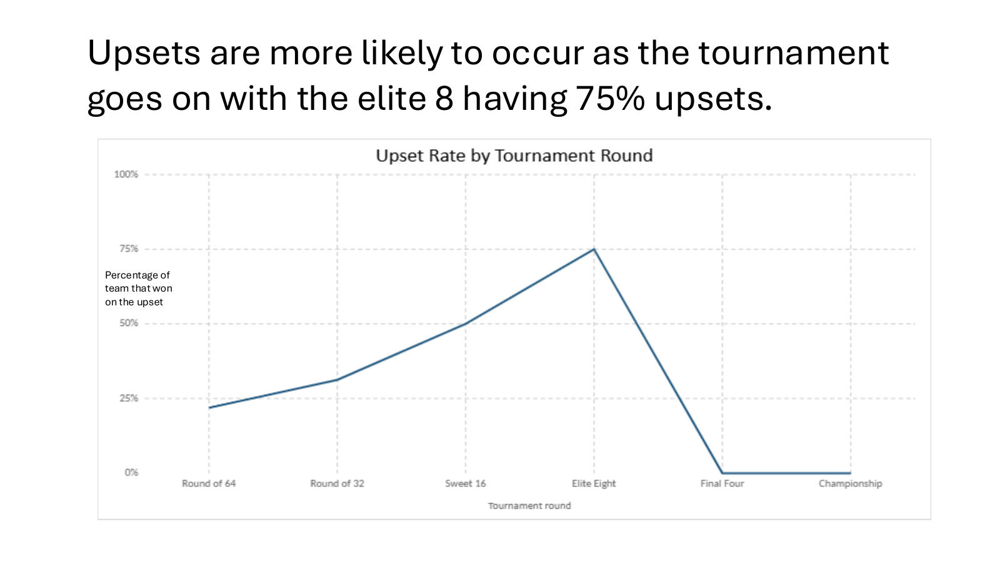
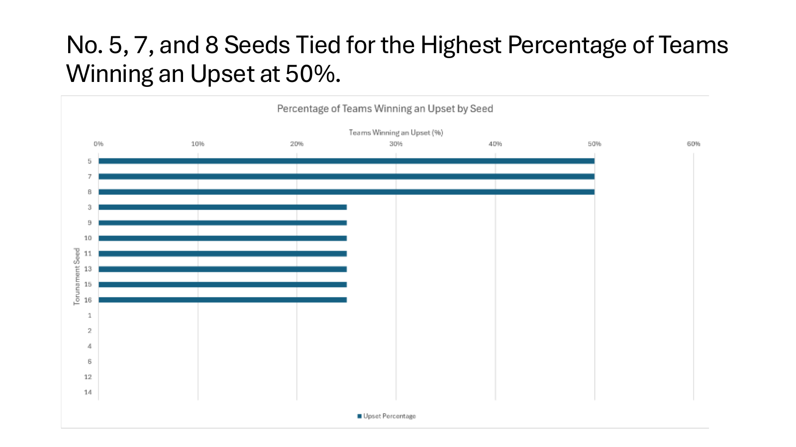
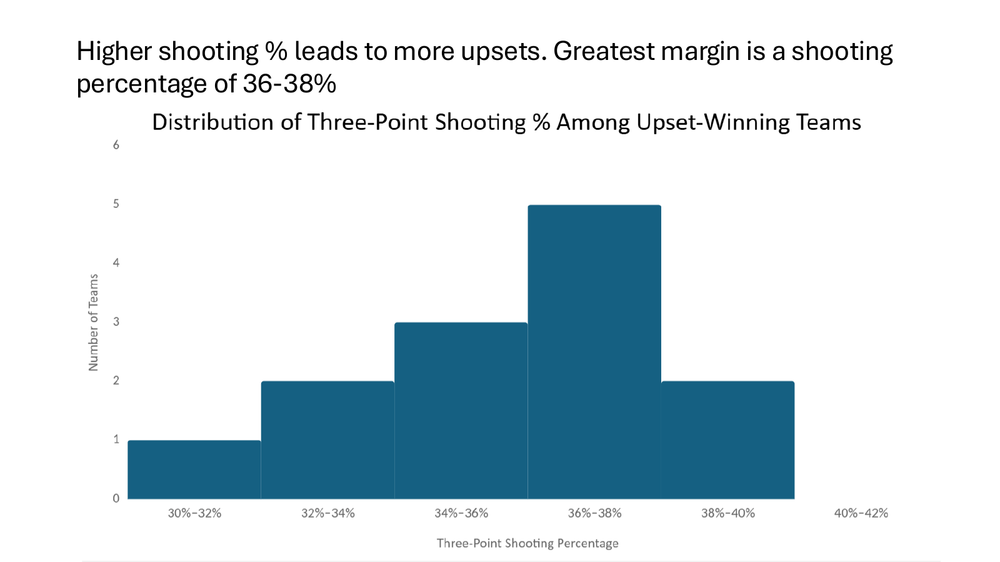
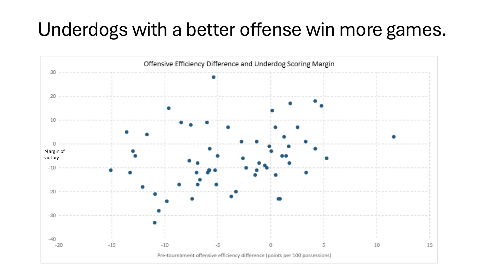

::: {.callout-note title="Local draft — awaiting team review"}
The Excel workbook and Connor's and Tomas's portfolio links will be added later. The date-versus-round description in Question 1 and the Excel methods for Questions 3–4 still need team confirmation. This draft has not been published.
:::

## Our team

[Blake Conrad](#0) · [Evan Charles](#0) · [Gavin Yanez](#0) · [Connor Anderson](#0) · ​ [**Tomas Ybarra**](https://btybarra66.github.io/)\

## The data behind the bracket

Our team used data for the 2023 March Madness tournament, combining two CSV files from Bart Torvik:

- [2023_team_results.csv](https://barttorvik.com/2023_team_results.csv)
- [2023_fffinal.csv](https://barttorvik.com/2023_fffinal.csv)

Our analysis considers tournament seeds, game outcomes, tournament progression, three-point shooting percentages, and pre-tournament offensive efficiency. Together, these measures let us explore when upsets happened and characteristics of the teams involved. The Excel workbook will be added here after the team completes its review.

We defined an **upset** as a game in which the team with the larger seed number defeated the team with the smaller seed number. These findings describe the tournament we studied; they do not guarantee what will happen in another season.

[View or download our presentation (PDF)](march-madness-slides.pdf){.btn .btn-primary}

## Question 1: How did the upset percentage change as the tournament progressed?

### Why this question is interesting

March Madness can feel increasingly unpredictable as teams advance. We wanted to see how the percentage of games ending in an upset changed as the 2023 tournament progressed, rather than relying on memorable games alone.

### How we used Excel

We marked a game as an upset when the team with the larger seed number beat the team with the smaller seed number. We then grouped the games by date and divided the number of upsets on each date by the total number of games played that day.

$$\text{Daily upset percentage} = \frac{\text{Upsets on that date}}{\text{Games played on that date}}\times 100\%$$

Using percentages let us compare days with different numbers of games. For example, March 25 had a 100% upset rate because both games played that day ended in upsets.

### How the visual was developed

For the date-based analysis, we created a line graph with game date on the horizontal axis and upset percentage on the vertical axis. Ordering the dates chronologically lets the reader follow how the rate changed over time.

### Assertion-evidence slide

{fig-alt="Line chart of upset rate by tournament round. Rates rise through the Elite Eight to 75%, then fall to zero for the Final Four and championship."}

::: {.callout-warning title="Reconcile the slide and method before publishing"}
The supplied slide summarizes **tournament rounds**, while the explanation above summarizes **dates**. These are different groupings. The slide peaks at 75% in the Elite Eight and then falls to 0%; its headline should not imply that the rate increased throughout the entire tournament. Confirm the grouping in the workbook and align the final slide and explanation.
:::

## Question 2: Which seeds had the highest percentage of teams winning an upset?

### Why this question is interesting

March Madness is known for its unpredictable outcomes, especially when lower-ranked teams defeat higher-ranked opponents. We wanted to determine which tournament seeds had the highest percentage of teams winning an upset. This helps us understand how tournament seeding relates to upset victories.

### How we used Excel

We used Microsoft Excel to analyze the tournament data and created a PivotTable to organize it by tournament seed and summarize the upset percentages for each seed. We then used those results to create a horizontal bar chart, allowing us to compare the percentages across seeds.

### How the visual was developed

The chart displays tournament seeds on the vertical axis and the percentage of teams winning an upset on the horizontal axis. We organized the results to make differences between seeds easy to identify. The slide's assertion highlights the three seeds tied for the highest percentage, while the chart provides the evidence supporting that conclusion.

### Assertion-evidence slide

**No. 5, 7, and 8 seeds tied for the highest percentage of teams winning an upset, each at 50%.**

{fig-alt="Horizontal bar chart showing No. 5, 7, and 8 seeds at 50%, the highest percentage of teams winning an upset in the team's analysis."}

## Question 3: What three-point shooting percentages were common among upset-winning teams?

### Why this question is interesting

Three-point shooting can help an underdog compete with a higher-seeded opponent. Examining the shooting percentages of upset-winning teams helps us describe whether those teams tended to fall into particular shooting ranges.

### How Excel was used — confirmation pending

The slide shows a frequency distribution of three-point shooting percentages among upset-winning teams. Its bins run in two-percentage-point intervals, and the vertical axis counts teams. The teammate responsible for this analysis still needs to confirm the filtering steps, the shooting-percentage field used, and how the frequency table or histogram was created in Excel.

### How the visual was developed

The displayed histogram places three-point shooting percentage ranges on the horizontal axis and number of teams on the vertical axis. Adjacent bars make it easy to compare the frequency in each interval. The tallest bar is the 36%–38% interval, containing five teams.

### Assertion-evidence slide

{fig-alt="Histogram of upset-winning teams' three-point shooting percentages. The highest bar is the 36%–38% interval with five teams."}

::: {.callout-note title="Interpretation to confirm with the team"}
The histogram shows the distribution **among upset-winning teams**. By itself, it does not establish that a higher shooting percentage causes an upset or increases the probability of one. A headline directly supported by this chart would be: **“The 36%–38% shooting interval contained the most upset-winning teams.”**
:::

## Question 4: How did offensive efficiency differences relate to underdog scoring margins?

### Why this question is interesting

Seeds summarize expectations, but they do not describe every team's strengths. Comparing offensive efficiency with scoring margin helps us explore whether an underdog's offensive strength was associated with how closely it competed.

### How Excel was used — confirmation pending

The slide compares pre-tournament offensive efficiency differences, measured in points per 100 possessions, with underdog scoring margins. The team still needs to confirm the Excel fields, subtraction order, included games, and steps used to create the scatter plot. Those details will be added with the workbook.

### How the visual was developed

The scatter plot places offensive efficiency difference on the horizontal axis and underdog scoring margin on the vertical axis. Points above zero on the vertical axis represent positive underdog margins; points below zero represent negative margins. Displaying the individual observations lets the reader see both the overall pattern and the variation around it.

### Assertion-evidence slide

{fig-alt="Scatter plot of pre-tournament offensive efficiency difference in points per 100 possessions against underdog scoring margin, with substantial variation among observations."}

The slide presents the team's conclusion that underdogs with a better offense win more games. The chart can help explore an association, but it does not establish that offensive efficiency alone caused the outcomes. The workbook is needed to verify the calculation and assess the strength of the relationship.

## Project files

- [Presentation slides (PDF)](march-madness-slides.pdf)
- **Excel workbook:** to be added after team review.

Before submission, our team will confirm the remaining methods, align Question 1's slide with its explanation, and use the same final project content on each member's ePortfolio.
