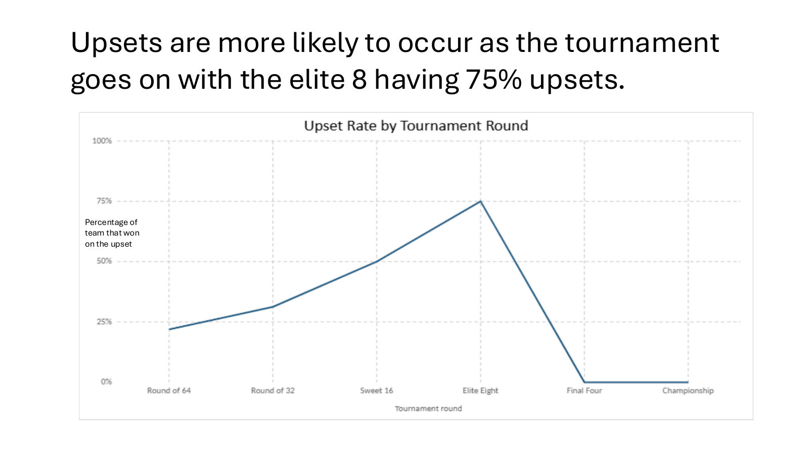
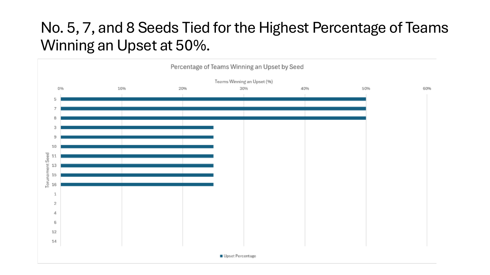
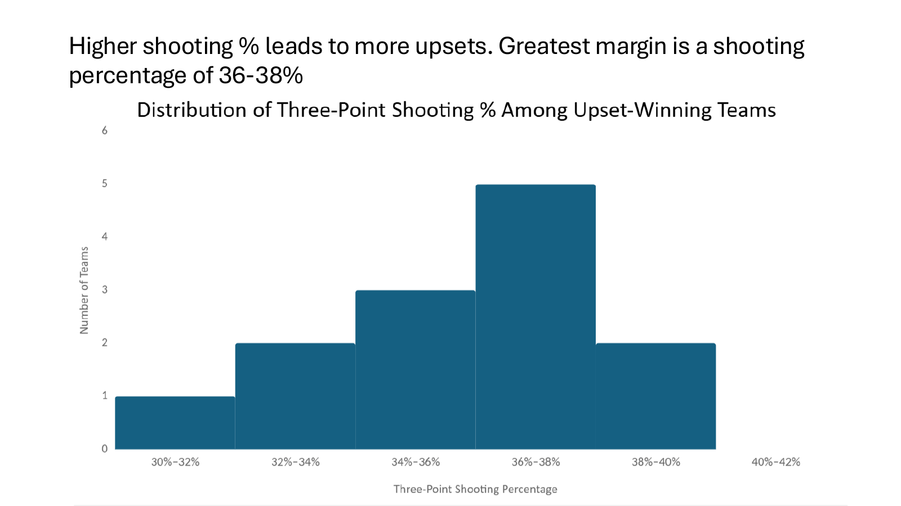
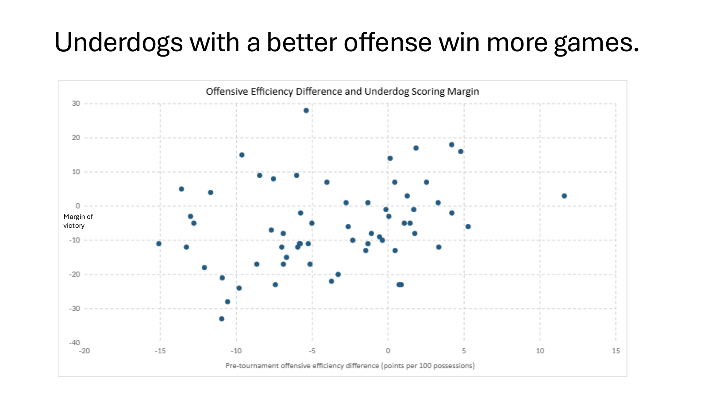

## Our team

[Blake Conrad](https://blake12340.github.io/) · [Evan Charles](https://jevancharles.github.io/) · [Gavin Yanez](https://gavin-yanez.github.io/) · [Connor Anderson](https://connor-a853.github.io/) · [Tomas Ybarra](https://btybarra66.github.io/)

## The data behind the bracket

March Madness is remembered for unexpected wins. Our project looks beyond individual highlights to explore how tournament progression, seed, three-point shooting, and offensive efficiency relate to upset outcomes in the **2023 NCAA men's basketball tournament**.

Our project materials identify two Bart Torvik data files: [2023 team results](https://barttorvik.com/2023_team_results.csv) and [2023 four-factor statistics](https://barttorvik.com/2023_fffinal.csv). The analysis presented in our slides combines team statistics with tournament seeds and results. The supplied spreadsheet export contains 64 team rows, with four teams at each seed from 1 through 16. It includes a Yes/No "Won an Upset" field, tournament upset-win counts, Three-Point %, and separate pre-tournament shooting and efficiency fields. Team-level comparisons describe seeds and shooting percentages; game-level comparisons describe tournament rounds and scoring margins. These are different units of analysis and should not be interpreted interchangeably.

An **upset** means a team with a larger seed number defeats a team with a smaller seed number. For example, a No. 9 seed beating a No. 8 seed is an upset under this definition. **Offensive efficiency** measures points scored per 100 possessions, allowing offenses to be compared on a common scale.

[View the presentation (PDF)](march-madness-slides.pdf){.btn .btn-primary}

*Data verification: The seed comparison and shooting histogram match the supplied spreadsheet PDF export. The export contains team statistics, not game-by-game results or editable Excel formulas. The round and scatter-chart workflows below explain the supplied slides but cannot be fully audited from that export. All original slide images are preserved.*

## Question 1: When were upsets most common?

### The question and why it matters

**How did the percentage of games ending in an upset change across tournament rounds?** We were interested in whether later rounds were more unpredictable than early rounds. Comparing percentages, instead of raw upset counts, matters because each successive round contains fewer games.

### Excel analysis

A game-level table needs the tournament round and the seeds of the winning and losing teams. An upset indicator assigns 1 when the winning seed number is larger than the losing seed number, and 0 otherwise. For example, an Excel table formula can use `=IF([@WinningSeed]>[@LosingSeed],1,0)`.

A PivotTable groups games by round, sums the upset indicator, and counts the games. Dividing the upset count by the game count gives the rate. Equivalently, the average of a complete 1/0 upset indicator within a round gives the same proportion. The results are formatted as percentages and ordered from the Round of 64 through the championship.

**Upset rate = number of upset games in the round ÷ total games in the round.**

This grouping matches the slide's horizontal axis: tournament rounds, rather than calendar dates. At the Elite Eight, three upsets out of four games give the displayed **75%**.

### Developing the visual

The slide uses a line chart to connect the rounds in their playing order. The percentage scale runs from 0% to 100%, giving a consistent reference for each round. The single blue line keeps attention on the rise to the Elite Eight and the drop afterward. The large headline states the takeaway, with the chart supplying the evidence.

### Assertion-evidence slide and interpretation

{fig-alt="Upset rate increases from the Round of 64 through the Elite Eight, where it reaches 75%, then drops to 0% in the Final Four and championship."}

**The Elite Eight had the highest displayed upset rate, at 75%.** The rate did not increase throughout the entire tournament: it fell to 0% in the Final Four and championship. The slide's opening claim therefore needs this qualification. Also, a high percentage in a four-game round is based on far fewer observations than a percentage in the 32-game opening round.

## Question 2: Which seeds produced the most upset-winning teams?

### The question and why it matters

**Which seeds had the highest percentage of teams winning an upset?** We wanted to see whether upset-winning teams were concentrated among particular seeds. This gives a more specific picture than treating every underdog as equally likely to succeed.

### Excel analysis

The project draft identifies a PivotTable organized by Tournament Seed. The supplied export confirms that the chart uses the Yes/No "Won an Upset" field: count Yes entries within each seed and divide by the four team rows for that seed. Seeds 5, 7, and 8 each have two Yes entries, giving 2 / 4 = 50%. This counts each team once rather than counting its total upset wins. In Excel, a helper column such as `=IF([@[Won an Upset]]="Yes",1,0)` can be averaged by seed in the PivotTable to reproduce the percentages.

**Percentage of teams winning an upset = teams at that seed with an upset win ÷ all included teams at that seed.**

The seed summary becomes the source range for a horizontal bar chart. This is a team-level measure, not the percentage of games won by underdogs. That distinction prevents a team that advances through several rounds from being counted repeatedly as separate teams.

### Developing the visual

The chart places tournament seeds on the vertical axis and percentages on the horizontal axis. Bars are ranked from the largest percentages to the smallest, making the leaders immediately visible. A shared zero baseline makes bar lengths directly comparable. The same blue color throughout keeps the emphasis on magnitude rather than suggesting unrelated categories.

### Assertion-evidence slide and interpretation

{fig-alt="Horizontal bars show seeds 5, 7, and 8 tied at 50%. Seeds 3, 9, 10, 11, 13, 15, and 16 are shown at 25%; the remaining seeds are at 0%."}

**No. 5, 7, and 8 seeds tied for the highest displayed percentage, at 50%.** This is a descriptive finding from the project data, not a guaranteed upset probability for future tournaments. A No. 1 seed cannot record a seed-based upset against a smaller seed number, so a 0% value for that seed does not indicate poor performance.

## Question 3: What shooting percentages characterized upset winners?

### The question and why it matters

**What three-point shooting percentages were most common among upset-winning teams?** Three-point shooting can help explain how underdogs compete. We wanted to describe the shooting profiles of teams that recorded upsets and identify the most common percentage range.

### Excel analysis

Filtering "Won an Upset" to Yes in the supplied export gives 13 team rows. Their values in the **Three-Point %** column reproduce the slide histogram; this is distinct from the separate **Pre-Tournament Three-Point %** column. In Excel, retain one row per selected team and group the Three-Point % values into equal intervals. The displayed bins are two percentage points wide: 30%-32%, 32%-34%, and so on through 40%-42%.

Excel's histogram tool, or a frequency table with consistent bin boundaries, counts how many observations fall in each interval. The chart displays counts of **1, 2, 3, 5, 2, and 0** across those six bins. These counts are reproduced with lower-inclusive, upper-exclusive intervals: for example, 34.0% belongs in 34%-36% and 36.0% belongs in 36%-38%. A frequency table can use COUNTIFS to count values greater than or equal to each lower boundary and less than the next boundary. The percentages are the source column values, not shooting percentages calculated from individual upset games.

### Developing the visual

A histogram is appropriate because shooting percentage is numeric and the question concerns its distribution. Equal-width intervals make frequencies comparable. Touching bars show that the intervals belong to a continuous scale, while the vertical axis reports the number of teams. A single color emphasizes the overall shape and the tallest interval.

### Assertion-evidence slide and interpretation

{fig-alt="Histogram with counts of 1, 2, 3, 5, 2, and 0 teams across two-percentage-point shooting intervals from 30% to 42%. The highest count is five in the 36%-38% interval."}

**The 36%-38% interval contains the most upset-winning teams: five.** The histogram describes winners only. It cannot establish that higher shooting percentages cause more upsets, or that teams in this interval have the greatest chance of an upset. Answering that would also require comparison with teams that did not win upsets. The tallest bar represents a frequency, not a scoring margin.

## Question 4: How did offensive strength relate to game results?

### The question and why it matters

**How did pre-tournament offensive efficiency differences relate to underdog scoring margins?** Seeds alone do not describe every team's strengths. We wanted to explore whether an underdog's offense was associated with a closer game or a victory against a higher-seeded opponent.

### Excel analysis

A game-level comparison pairs each underdog with its opponent and uses two numeric columns: pre-tournament offensive efficiency difference and final scoring margin. A consistent underdog-centered calculation is:

- **Offensive efficiency difference = underdog efficiency − opponent efficiency**, in points per 100 possessions.
- **Underdog scoring margin = underdog final score − opponent final score**, in points.

These paired columns can be selected in Excel to insert an **XY scatter chart**, with efficiency difference assigned to X and scoring margin to Y. Each point then represents one game. The export confirms that a Pre-Tournament Offensive Efficiency field is available. It does not include the opponent pairings or final game scores, so the subtraction convention and exact game inclusion rules cannot be independently confirmed from this file.

### Developing the visual

A scatter chart preserves each pair of numeric measurements instead of grouping them into categories. Efficiency difference appears horizontally and scoring margin vertically. Positive scoring margins indicate underdog wins; negative margins indicate losses. Showing the zero values makes the outcomes easier to interpret. The unconnected points also reveal how much game results vary, rather than implying a smooth or certain relationship.

### Assertion-evidence slide and interpretation

{fig-alt="Scatter chart comparing pre-tournament offensive efficiency difference in points per 100 possessions with underdog scoring margin. Both wins and losses appear across the plotted efficiency differences, with substantial variation."}

**Offensive efficiency differences can help explore underdog performance, but the points show substantial variation.** The slide proposes that underdogs with better offenses win more games. The plot alone does not quantify that claim: a win-rate comparison or statistical analysis would be needed to measure it. Offensive strength is one possible factor, not a guarantee of victory or proof of causation.

## What we learned

Different charts answer different questions. The line chart shows progression across ordered rounds, the bar chart compares seeds, the histogram describes a distribution, and the scatter chart explores an association. Using clear labels, consistent units, and a specific headline helps readers connect each assertion to its evidence. Just as importantly, the written explanation should avoid claiming more than the chart can demonstrate.

The seed and shooting results reproduce the supplied "Won an Upset" coding as recorded. They are not an independent audit of that coding against every tournament game.

## Project files and sources

- [Download the team's assertion-evidence slides (PDF)](march-madness-slides.pdf)
- [Bart Torvik: 2023 team results (CSV)](https://barttorvik.com/2023_team_results.csv)
- [Bart Torvik: 2023 four-factor statistics (CSV)](https://barttorvik.com/2023_fffinal.csv)

This page documents the supplied team presentation. Results are specific to the project data and should not be treated as predictions for a future tournament.

